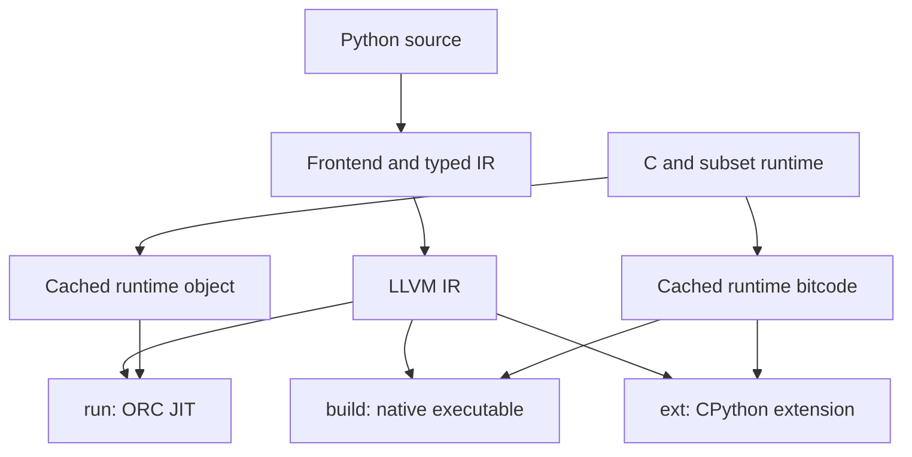

# How Pystachy works

Pystachy's compiler is written in the typed Python subset it compiles. A CPython-hosted
compiler and a native compiler use the same frontend, typed IR and LLVM lowering.
The runtime combines C with functions written in that subset.

For supported syntax and behavior, read the [language guide](language.md). For the IR's
contracts and passes, read [typed IR](typed-ir.md). The [testing guide](testing.md)
explains differential checks and bootstrap validation.

## Repository layout

| Path | Purpose |
|---|---|
| `pystachy.py` | Compatibility entry point for the hosted and self-hosted compiler |
| [`src/pystachy_compiler/`](../src/README.md) | Lexer, parser, scope checks, module loader, type checker, typed IR, LLVM lowering and driver |
| `runtime.c` | Allocation and collection, container storage, files, numeric support and exception unwinding |
| `runtime.py` | Runtime functions written in the subset; see [runtime in the subset](runtime-in-subset.md) |
| `lib/`, `ports/` | Standard-library modules and adapted third-party packages; see [library support](stdlib.md) |
| `ryu/` | Ryu's float-to-string conversion, with its upstream license; see [Ryu's README](../ryu/README.md) |
| `tests/`, `tools/` | CPython comparisons, rejection cases, IR probes, fuzzers and validation tools |
| `bench/`, `examples/` | Performance workloads and complete applications |
| `pyext.c`, `pyembed.c` | CPython extension glue; see [foreign functions](ffi.md) |

## Compilation pipeline

The frontend runs these stages before LLVM sees the program:

| Stage | Responsibility |
|---|---|
| `Lexer`, `Parser`, `Symtable` | Decode and parse source; check syntax and scope rules, including code that will not be compiled |
| `Loader` | Find imports, qualify module names, and resolve supported import-time decisions |
| `Flow` | Identify reads that need an assignment check |
| `Gen` | Declare interfaces, check and infer types, specialize templates, and build typed IR |
| IR passes and lowering | Compute effects, optimize eligible operations, lower exception handling, and print LLVM IR |

## Frontend and specialization

Imports become qualified names in one compiled program, rather than runtime module objects.
Each module has an initialization function that runs its body when first imported.
Definition-time checks preserve the relevant annotation, default-value and import behavior;
see the [module reference](language/modules.md).

`Gen` checks each function while building its IR. Expected types flow into expressions;
inferred types flow out. Static branches determine which bodies need checking, and
unannotated function parameters cause specialization at calls. Constructor-inferred class
templates create ordinary compiled classes for their field types. The
[typing reference](language/typing.md) describes the supported forms and limits.

Ordinary single-inheritance hierarchies carry a class tag. Base-typed instance-method calls
select a concrete implementation, then reuse method specialization for that receiver.
Inherited fields keep the base layout; unrelated classes retain their existing layout.
Explicit base calls and `super()` select a body directly while preserving the receiver.

A known function value can become a direct call. Closures keep captured variables in shared
cells, so `nonlocal` assignments remain visible. A typed `Callable` uses an adapter with a
code pointer and an environment pointer for indirect calls.

The preceding `Flow` pass marks reads it cannot prove initialized. Generated checks then
raise the appropriate error; LLVM can remove checks it proves redundant. Optional-value
narrowing is a separate typing concern.

## Typed IR and LLVM

The IR contains one `IFn` per compiled function, with basic blocks, instructions, loop
metadata and exception-handler metadata. Runtime signatures and effects come from the
`RUNTIME` table. Whole-program effect summaries support list-read and dictionary-lookup
optimizations and identify calls that need exceptional edges.

This separation is already used by JIT and AOT. It is incomplete: most loads, stores and
arithmetic remain `raw` instructions containing LLVM text. There is no second backend yet.
See [typed IR](typed-ir.md) for the exact boundary between shipped machinery and future work.

Locals start in entry-block `alloca` slots. LLVM's `mem2reg` builds SSA form; expression joins
also use explicit `phi` instructions. Each function's typed IR is released after lowering,
while its effect summary remains available.

## Values and runtime

Scalars use LLVM's `i64`, `double` and `i1`; strings, containers and objects use pointers.
Container elements occupy uniform eight-byte slots, allowing one runtime implementation to
serve multiple static element types. Optional reference values use null for `None`; optional
numbers use boxes. Integers use checked 64-bit arithmetic rather than CPython's arbitrary
precision.

Generic operations such as comparison, representation and sorting receive a compact type
descriptor. The runtime interprets nested container descriptors and calls generated helpers
for supported object methods. Specialized code still has static types; these descriptors
do not introduce a dynamic `Any` type.

The collector is conservative, non-moving mark-and-sweep. It scans stack/register roots and
registered program globals; buffers that cannot contain pointers are not scanned. Unreachable
files close during collection or at program exit. Supported Python operations are checked
against CPython; the [compatibility reference](language/compatibility.md) lists deviations.

`runtime.py` is compiled in a restricted runtime mode using `_rt` primitives, then linked with
`runtime.c`. This reuses the compiler for string methods, formatting and numeric helpers.
The [runtime guide](runtime-in-subset.md) covers those primitives and their constraints.

## Errors and cleanup

Overflow, invalid receivers and uninitialized reads branch to shared cold error blocks.
For programs that use `try` or `with`, exception lowering gives may-raise calls explicit
unwind edges to LLVM landing pads. The runtime unwinds through native frames using its own
personality routine; local raises can branch directly to their handler.

Handlers match exception classes and rethrow unmatched exceptions. `finally` and `with`
cleanup run on the relevant normal and exceptional exits. Nested `finally` handling avoids
exponential duplication. The C runtime is compiled with exception support in both tiers.

## Generators

A generator function compiles to an LLVM switched-resume coroutine (`presplitcoroutine`), and
LLVM's coroutine passes do the work a hand-written state machine would: CoroSplit finds the
values live across each `yield`, lays out the frame and outlines the resume and destroy
functions, and CoroElide puts the frame of a generator a loop owns into the loop's own frame
(HALO) once the generator's ramp is inlined. The typed IR marks the coroutine's structure
with closed operations (`docs/typed-ir.md`): `gen.start` ends the entry block (`coro.id`,
`coro.alloc`, a frame from `pys_alloc` that the collector scans, the promise, and the initial
suspend that makes a call run none of the body), `gen.yield` and `gen.ret` suspend it (all
returns share the one final suspend), `gen.promise` addresses a promise, `gen.resume` resumes
a handle (an `invoke` in a `try`), and `gen.drop` closes and destroys a generator a loop owns.
`coro.free` frees nothing: the collector reclaims an unreachable frame, and an elided frame
lives in a scanned stack frame.

A generator object is the coroutine's handle, so every generator that yields `Y` has the type
`gen[Y]` (shown as `Generator[Y]`), whatever function made it. The promise holds five words:
the value yielded last, the value returned (`r = yield from g()`), the state (suspended, suspended
where closing it runs its code, finished, running), the consumer's command (close) and the
generator's `__qualname__`. A consumer checks the state before it resumes (a finished generator
is never resumed; a running one raises `ValueError`) and after (finished: the loop ends).
`for_seq` takes a generator as one more kind of sequence, so `for`, `enumerate()`, `zip()` and
comprehensions iterate generators; consumers that take all items read them into a list, and
`sum()`, `min()`, `max()`, `any()` and `all()` take them as a generator expression would.

With exceptions on (a program with `try` or `with`), a landing block covers a generator's body:
an exception that leaves it marks the generator finished and goes on (a `StopIteration` as PEP
479's `RuntimeError`). A loop over a generator its iterable has just made (a call of a generator
function) owns it: `gen.drop` runs where the loop is left, and when closing may run code of the
generator (a `yield` in `try`, `with`, `yield from` or a loop of its own), the loop is the body
of a `try` whose finally block drops it, so an exception in the body closes it too. Closing
resumes the generator with the close command, and the `yield` raises `GeneratorExit` there,
which its `finally`, `with` and `except GeneratorExit` see; the generator's landing block ends
it, and reports anything else, as `pys.gen.drop` reports a `yield` after `GeneratorExit`. A
suspended generator keeps none of its exception state among its consumer's: it sets its `with`
blocks' unwind actions aside (`pys_gen_leave`, `pys_gen_enter`), its `try` statements' marks
are relative to the depth where it was last resumed, and the exception it handles in an
`except` clause or a `finally` block is its own again when it resumes.

A generator expression that no consumer takes directly becomes an anonymous generator
function, called with its first iterable (evaluated where it is written) and the values of
the enclosing function's variables it reads. Programs without `yield` and without such
generator expressions emit the same typed IR and LLVM IR as before.

## JIT, AOT and runtime caching

`run` favors startup latency. LLVM removes unused internal functions, optionally inlines the
program's own functions, performs SSA cleanup, then ORC JIT runs with the cached runtime
object. A module that holds generators (coroutines, which `lli` cannot run before they are
lowered) gets LLVM's coroutine passes around that pipeline:
`coro-early`, `coro-split` in the bottom-up walk that inlines (with `coro-elide` after each
function's cleanup), and `coro-cleanup`; other modules keep the same `opt` command. The default inlining threshold is 20,000 lines of generated IR; larger programs skip
that pass. The precompiled runtime is not inlined into JIT code.

`build` links the runtime bitcode with the program and applies clang's `-O2` optimization
pipeline, allowing optimization across that boundary. `ext` builds a shared CPython module
with its boundary wrappers; see the [FFI guide](ffi.md).

Cached runtime artifacts depend on the runtime sources, included Ryu files, compiler,
LLVM tools and compilation flags. Changes invalidate the relevant cache. Builds use private
temporary files and publish reusable artifacts only after checking their inputs stayed stable.

## Bootstrap validation

CPython runs the compiler as stage 0. That compiler builds stage 1, and stage 1 builds stage 2.
The bootstrap checks that all three emit identical LLVM IR for the compiler and `runtime.py`.
This fixed point catches disagreements that affect self-compilation; differential tests
provide the broader behavior check. See [testing](testing.md) for the commands.

## Environment variables

| Variable | Effect |
|---|---|
| `PYSTACHY_LLVM` | Override the LLVM tool directory (Linux 18, macOS 20); standard apt/Homebrew locations are discovered before falling back to `PATH` |
| `PYSTACHY_HOME` | Directory holding the runtime and `lib/`; set by the installed launcher |
| `PYSTACHY_CACHE` | Runtime cache directory; checkout default is `build/`, installed default is `${XDG_CACHE_HOME:-$HOME/.cache}/pystachy` |
| `PYSTACHY_PATH` | Additional import directories, separated by `:` |
| `PYSTACHY_CFLAGS` | Extra clang flags for runtime compilation and AOT linking; part of the cache key |
| `PYSTACHY_IRCHECK=1` | Verify typed IR before lowering and after transforming passes |
| `PYSTACHY_IRFX=1` | Print function effect summaries to stderr |
| `PYSTACHY_OPT` | Disable named optimizations with `-name`, comma-separated, or all with `-all`; see [IR passes](typed-ir.md#optimizations) |
| `PYSTACHY_JIT_INLINE=N` | IR-line threshold for JIT inlining; `0` disables it |
| `PYSTACHY_GC_STRESS=N` | Collect every N allocations |
| `PYSTACHY_GC_STRESS_PROGRAM=N` | Apply the stress interval to the program run by JIT or the test runner, separately from its compiler |
| `PYSTACHY_GC` | `off` disables collection; `stats` prints a summary at exit |
| `PYSTACHY_JOBS` | Parallelism for the test runner and IR tools |

For AddressSanitizer builds, set `ASAN_OPTIONS=detect_stack_use_after_return=0`: its fake stack
is outside the collector's scanned stack. Sanitizer flags instrument the C runtime and final
link; they do not directly instrument the generated code of `runtime.py`.
